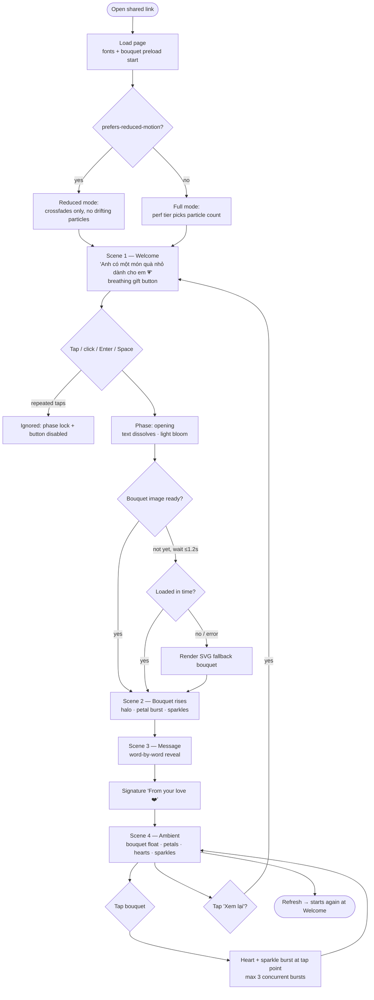

# Plan: Romantic Interactive Flower Gift Website (20/10)

## Summary

A single-page website that works like a digital gift for Vietnamese Women's Day. It opens on a soft blush welcome screen with a breathing gift button. Pressing the button starts a reveal: the welcome text fades out, light blooms across the screen, and a bouquet rises into view surrounded by petals and sparkles. A Vietnamese love message then appears word by word, followed by a signature. After that, the page stays alive with petals, hearts and sparkles, and tapping the bouquet makes it bloom with hearts.

The site is static: React + TypeScript + Vite + Tailwind v4 + Motion, with the ambient effects in CSS. It needs no backend and can be deployed to Vercel from a shareable URL.

## User Story

As someone giving a gift on 20/10,
I want to send my girlfriend a link that opens into a beautiful, animated flower-gift experience,
So that she feels surprised, cherished, and moved, and it feels like opening a real present rather than visiting a website.

## Problem → Solution

There's no project yet (the directory is empty) → a polished, mobile-first, static gift site, deployed with a private shareable URL and tested on her likely device and in-app browser (Messenger/Zalo).

## Metadata

- **Complexity**: Large (new project, ~30 files, animation choreography, asset pipeline)
- **Source PRD**: N/A (free-form brief)
- **PRD Phase**: N/A
- **Estimated Files**: ~32 created, 0 modified
- **Deadline**: **Today, 2026-10-20.** The phases are ordered so a deployable MVP exists after Phase 4 (about 3–4 focused hours). Later phases add polish.

---

## 0. Codebase Inspection Result

`C:\Users\Bui Nguyen Minh Quan\2020` is **empty**: no git repo, no package.json, no existing conventions. Node `v22.20.0` and npm `11.21.0` are installed. There are no existing patterns to follow, so this plan **sets the conventions** (Section 10, "Conventions").

---

## 1. Product Overview & Emotional Experience

**Emotional arc (about 10 seconds from tap to full message):**

| Beat | Feeling | Mechanism |
|---|---|---|
| Arrival | Curiosity, warmth | A quiet blush screen, slow drifting petals, a single breathing button. Restraint makes it feel premium. |
| The press | Anticipation | The button presses in, the text dissolves upward, light blooms from the button. |
| The reveal | Wonder | The bouquet rises out of the light, a soft halo glows behind it, petals scatter. |
| The words | Being loved | The message appears word by word at reading pace, then the handwritten-style signature. |
| Afterglow | Lingering | The scene stays alive. Tapping the bouquet answers her with hearts. |

**Design stance:** *romantic minimalism.* There's one hero (the bouquet), a calm palette, a lot of air around it, and motion that is slow and eased rather than bouncy. Every effect has a count cap and a low opacity so it stays tasteful.

---

## 2. User Interaction Flow



### Phase state machine

```
welcome ──(GIFT_CLICKED)──▶ opening ──(BLOOM_DONE)──▶ revealing ──(BOUQUET_SETTLED)──▶ message ──(MESSAGE_DONE)──▶ ambient
   ▲                                                                                                             │
   └────────────────────────────────────────(REPLAY)─────────────────────────────────────────────────────────────┘
```

- The reducer accepts each event **only in its source phase**. A second `GIFT_CLICKED` while in `opening` does nothing, which makes repeated clicks safe.
- Phase transitions are driven by `onAnimationComplete` of the key element. Timer fallbacks with cleanup guarantee progress even if a frame-throttled tab never fires the callback.

---

## 3. Scene-by-Scene UI/UX Specification

### Global stage (all scenes)

- **Background:** stacked radial gradients, not a flat fill:
  - Base `#FFF7FA` → `#FFF0F5`
  - A warm champagne light at the top-left (`#F6E3CC` at 35% opacity)
  - A rose pool at the bottom-right (`#F8C8DC` at 50%)
  - A very faint vignette at the edges (`#75445C` at 4%)
- **Film grain:** an inline SVG `feTurbulence` noise overlay at 3–4% opacity. This gives the paper-like, tactile feel that separates premium from flat. It's static and never animated.
- **Bokeh orbs:** 3–4 large soft circles drawn with `radial-gradient` (**not** `filter: blur`, which is expensive), drifting very slowly (40–60s loops).
- **Layout container:** `min-height: 100svh` (with a `100vh` fallback), `env(safe-area-inset-*)` padding, `overflow: hidden` on the particle layer only.

### Scene 1 — Welcome

| Element | Spec |
|---|---|
| Ambient | 8–12 petals falling slowly, 3–4 tiny hearts rising and fading, bokeh orbs. Calmer than Scene 4. |
| Kicker (optional) | "20 · 10" in small caps, letter-spacing 0.3em, champagne gold, Be Vietnam Pro 500, 12–13px. Shows the occasion quietly. |
| Heading | "Anh có một món quà nhỏ dành cho em 💗". Cormorant Garamond 500 italic, `clamp(1.75rem, 6vw, 3rem)`, color `#75445C`, max-width 18ch, centered, balanced wrapping (`text-wrap: balance`). |
| Entrance | Kicker fades in (0.6s). Heading rises 16px → 0 with opacity 0 → 1 (0.9s, ease `[0.22,1,0.36,1]`), starting at 0.3s. Button follows at 0.9s. |
| Gift button | "Nhấn vào đây để nhận quà 🎁". Pill shape, min-height 52px, padding 16×32. Gradient `#F4A6BC → #E88AA6`, white text in Be Vietnam Pro 600 at 16px, a 1px inner hairline in champagne at 40%, soft pink shadow. |
| Breathing | Scale 1 → 1.03 → 1 plus a glow-ring pseudo-element at opacity 0.35 → 0.75, over 2.8s ease-in-out, looping. Animate only transform and opacity, **never box-shadow**. |
| Hover (pointer devices only) | Lift −2px, plus a shimmer: a diagonal white gradient band sweeps across once (`translateX`), 0.9s. Wrapped in `@media (hover: hover)` so the effect doesn't stick on touch screens. |
| Press | Scale 0.97 for 120ms. On touch, `touch-action: manipulation` removes the 300ms tap delay. |
| Focus | `:focus-visible` shows a 3px champagne ring with a 3px offset. |
| Below the button (optional) | A tiny hint, "(bật âm thanh để trọn vẹn hơn 🎶)", **only if** music is approved (Open Decision D2). |

### Scene 2 — Gift Reveal

1. **Button press.** The button squeezes, and a ripple ring expands from the tap point.
2. **Dissolve.** The heading and button fade out, drift up 12px, and blur 0 → 6px (small elements, so blur is affordable), over 0.6s.
3. **Light bloom.** A full-screen radial gradient (white → `#FFE4EE` → transparent), centered on the button, scales 0.2 → 2.2 while opacity goes 0 → 0.9 → 0. This is the "lid opening" moment that hides the swap between scenes.
4. **Bouquet entrance.** Starts at opacity 0, scale 0.86, y +48px, blur 8px. Ends at opacity 1, scale 1, y 0, blur 0, over 1.4s with ease `[0.16,1,0.3,1]`. Blur is applied to a wrapper only during the entrance and then removed (set `filter: none`) so it never stays on a large layer.
5. **Halo.** A soft radial glow behind the bouquet (gold-to-pink) fades in and scales 0.8 → 1.
6. **Petal burst.** 10–14 petals shoot outward radially from behind the bouquet, then drift down and fade (one-shot, 1.6s).
7. **Sparkles.** 6–8 four-point star sparkles twinkle at fixed positions around the bouquet silhouette.
8. **Depth.** There are three layers: the background halo and bokeh, the bouquet, and foreground petals. Desktop gets pointer parallax (±6px on the background, ±10px on the foreground, smoothed with a spring). On mobile the drift is autonomous (iOS gyroscope access requires a permission prompt, which would break the magic).

### Scene 3 — Romantic Message

- **Text:** "Chúc em 20/10 thật xinh đẹp, luôn vui vẻ và hạnh phúc. Cảm ơn em vì đã xuất hiện trong cuộc đời anh. Yêu em rất nhiều! ❤️"
- **Typography:** Cormorant Garamond 500, `clamp(1.125rem, 4.2vw, 1.75rem)`, line-height 1.55, color `#75445C`, max-width 34ch, centered, `text-wrap: pretty`.
- **Animation:** **word-by-word**. Each word goes opacity 0 → 1, y 8 → 0, blur 4 → 0, over 0.6s, with a 70ms stagger between words. The three sentences are separate lines/blocks, with an extra 250ms "breath" pause between sentences so it reads like being spoken.
  - **Why words and not characters:** Vietnamese uses stacked diacritics (ữ, ặ, ờ). Per-character splitting risks separating combining marks and looks busy. Words keep the meaning intact.
- **Emphasis:** "Yêu em rất nhiều!" is a touch larger and in Cormorant Garamond **italic 600**, with a slow champagne-gold shimmer gradient (`background-clip: text`) that sweeps once.
- **Signature:** "From your love ❤️" in Dancing Script 500, `clamp(1.25rem, 4.5vw, 1.75rem)`, in rose `#C9718F`. It's right-aligned under the message and fades in with a slight 3° rotation settling to 0.
- **Accessibility:** the animated word `<span>`s are `aria-hidden`. The full sentence lives in a visually hidden `<p>` inside an `aria-live="polite"` region, so a screen reader reads it once, naturally.

### Scene 4 — Continuous Atmosphere

| Effect | Spec | Count by tier (high / mid / low / reduced) |
|---|---|---|
| Falling petals | 3 SVG petal shapes in pink/rose/blush. Each falls with its own sway, rotation, duration (12–22s) and delay. | 16 / 10 / 6 / 0 |
| Rising hearts | Small outline and filled hearts rising from the bottom and fading. Long loops with staggered delays, so they show up "occasionally". | 5 / 3 / 2 / 0 |
| Sparkles near the bouquet | Twinkle (scale + opacity) at random 3–6s intervals. | 8 / 6 / 4 / 3 static |
| Bouquet float | y 0 → −8px → 0 plus rotate −0.6° → 0.6°, 6s ease-in-out, looping. | on / on / on / off |
| Halo breathing | opacity 0.7 ↔ 1, 5s. | on / on / off / off |
| Tap burst | Tapping the bouquet makes it squeeze (scale 0.98 → 1). 6–8 hearts and sparkles burst from the tap point upward/outward and fade (1.1s). At most 3 concurrent bursts; each removes itself when its animation completes. | on / on / on (4 particles) / a single heart fade |
| Tap hint | "Chạm vào bó hoa nhé 💕" appears 1.5s after the signature, in small, faint text. It hides permanently after the first tap. | on |
| Replay | A subtle "Xem lại ↺" text button in the bottom corner, at opacity 0.6, shown in the ambient phase. Pressing it returns to welcome. *(Open Decision D5)* | on |

---

## 4. Component Architecture

```
<App>                              phase state machine (useReducer), MotionConfig, LazyMotion
 ├─ <AmbientBackground/>           gradients, grain, bokeh: always mounted, never re-renders
 ├─ <FloatingPetals density/>      CSS-keyframe particles; density depends on phase + tier
 ├─ <FloatingHearts density/>
 ├─ <AnimatePresence mode="wait">
 │   ├─ phase=welcome   → <WelcomeScene onOpen/>
 │   │                      ├─ <Kicker/>
 │   │                      ├─ <WelcomeHeading/>
 │   │                      └─ <GiftButton disabled={phase!=='welcome'}/>
 │   └─ phase≥revealing → <RevealScene phase/>
 │                          ├─ <Bouquet onSettled onTap/>
 │                          │    ├─ <BouquetHalo/>
 │                          │    ├─ <BouquetImage/>   ← <picture> AVIF/WebP, onError → <BouquetFallback/>
 │                          │    ├─ <Sparkles/>
 │                          │    └─ <TapBurstLayer/>
 │                          ├─ <PetalBurst/>          one-shot
 │                          ├─ <RomanticMessage active onDone/>
 │                          │    ├─ <AnimatedWords/>
 │                          │    └─ <Signature/>
 │                          ├─ <TapHint/>
 │                          └─ <ReplayButton/>
 └─ <LightBloom active={phase==='opening'} onDone/>   overlay, pointer-events: none
```

**Responsibilities and contracts**

| Unit | Input | Output / side effect |
|---|---|---|
| `experienceReducer(state, event)` | `Phase`, `ExperienceEvent` | Next `Phase`. Pure, unit-tested. |
| `usePerformanceTier()` | `matchMedia`, `navigator.hardwareConcurrency`, `deviceMemory`, `connection.saveData` | `'high' \| 'mid' \| 'low'`, computed once |
| `useReducedMotion()` (from Motion) | OS setting | boolean |
| `useBouquetPreload(src)` | image URL | `'loading' \| 'ready' \| 'error'`. Uses `new Image()` and `img.decode()`. |
| `usePointerParallax(ref, strength)` | pointer events (only when `hover: hover` and not reduced) | Motion values `x` and `y`, smoothed with a spring. Removes its listener on unmount. |
| `useTapBursts(max=3)` | pointer coordinates | Array of bursts plus `add()`/`remove(id)` |
| `createParticles(count, seed)` | count | Stable array of `{left, delay, duration, drift, rotate, scale, variant}`. Created once with `useMemo`, so re-renders don't reshuffle. |
| `copy.ts` | — | **Every** Vietnamese string lives here. No hard-coded copy in components. |
| `timeline.ts` | — | Every duration, delay and easing value in one place, so the choreography can be tuned from a single file. |

---

## 5. Technology Stack & Justification

| Layer | Choice | Why | Rejected alternatives |
|---|---|---|---|
| Build | **Vite** (latest stable) | Instant dev server, static `dist/`, zero-config deploys on Vercel and Netlify | Next.js: SSR/routing would be dead weight for one static page |
| UI | **React 19 + TypeScript** | The scene and phase model maps cleanly to components, and `AnimatePresence` exit animations need React. TypeScript keeps the timeline and particle configs safe. | **Vanilla TS + GSAP**: genuinely viable and about 40KB lighter. It loses only because of the stated preference and because declarative exit animations make the code easier to maintain. Revisit only if the bundle budget is blown. |
| Styling | **Tailwind CSS v4** (`@tailwindcss/vite`) | Design tokens via `@theme` in CSS, mobile-first utilities, no runtime cost | CSS Modules: fine, but slower to iterate on visual polish |
| Choreography | **Motion** (`motion` package, `motion/react`) using `LazyMotion` + `m` + `domAnimation` | Entrance/exit, variants, stagger, springs, `useReducedMotion`. `LazyMotion` cuts the bundle to roughly 15–20KB gzipped. | **GSAP**: excellent timelines and now free, but it duplicates Motion here. Picking one engine avoids two mental models. |
| Ambient particles | **CSS keyframes** on a capped pool of DOM nodes, with values passed in through CSS custom properties | Runs on the compositor thread, needs no JS per frame, is paused automatically in background tabs, and has nothing to clean up | **Canvas**: not justified at fewer than 30 particles. It would add a requestAnimationFrame loop, DPR handling, resize handling, and accessibility work for no visible gain. |
| Fonts | **@fontsource** packages (self-hosted, `vietnamese` + `latin` subsets only) | No Google Fonts request (which can be slow from VN mobile networks or blocked in some in-app browsers), and the font bytes are predictable | Google Fonts CDN |
| Tests | **Vitest** + **@testing-library/react** + **jsdom** | Fast, shares the Vite config. Covers the logic: reducer, particle generator, perf tier, word splitting. | Playwright: overkill for a one-off gift. Real-device manual QA is worth more. |
| Lint | ESLint flat config from the Vite template | Standard | — |
| Deploy | **Vercel** (static) | `vercel --prod` or a Git import, free HTTPS, a shareable URL in minutes | Netlify: equally fine (drag-and-drop `dist/`) |

**Performance budget**

| Resource | Budget (gzipped) |
|---|---|
| JavaScript | ≤ 90KB total (React about 60KB + Motion lazy about 18KB + app code) |
| CSS | ≤ 15KB |
| Fonts | ≤ 120KB, 3 families, only the weights actually used |
| Bouquet image | ≤ 250KB (AVIF), with a WebP fallback ≤ 350KB |
| LCP on simulated 4G (Lighthouse mobile) | < 2.5s |

---

## 6. Animation Timeline & Sequencing

All values live in `src/config/timeline.ts`. Times are in **ms from the event**.
Default ease `EASE_OUT = [0.22, 1, 0.36, 1]`. Bouquet ease `EASE_SILK = [0.16, 1, 0.3, 1]`.

### Welcome entrance (t = page ready)

| t | Element | Animation | Duration |
|---|---|---|---|
| 0 | Background and bokeh | already present (no flash), bokeh drift starts | loop |
| 0 | Welcome petals | start with negative delays so they're already mid-fall | loop |
| 150 | Kicker "20 · 10" | opacity | 600 |
| 300 | Heading | opacity, y 16 → 0 | 900 |
| 900 | Gift button | opacity, y 12 → 0, scale 0.96 → 1 | 700 |
| 1700 | Gift button | breathing loop starts | 2800 loop |

### Reveal (t = 0 at click)

| t | Element | Animation | Duration |
|---|---|---|---|
| 0 | Phase | `welcome → opening`, button disabled | — |
| 0 | Button | scale 0.97, ripple ring expands | 120 / 600 |
| 80 | Heading + button | opacity → 0, y → −12, blur → 6px (exit) | 600 |
| 350 | LightBloom | scale 0.2 → 2.2; opacity 0 → 0.9 (at 45%) → 0 | 1400 |
| 900 | Phase | `opening → revealing` (bloom at peak hides the swap) | — |
| 900 | Bouquet | opacity 0 → 1, scale 0.86 → 1, y 48 → 0, blur 8 → 0 | 1400 |
| 1100 | Halo | opacity 0 → 1, scale 0.8 → 1 | 1200 |
| 1500 | PetalBurst | radial burst, one-shot | 1600 |
| 1800 | Sparkles | staggered twinkle-in, 80ms apart | 600 each |
| 2300 | Phase | `revealing → message` (on bouquet `onAnimationComplete`) | — |
| 2300 | Bouquet | float loop starts; parallax enabled | loop |
| 2300 | Ambient petals/hearts | density ramps from welcome level to full (new nodes fade in) | 1500 |
| 2500 | Message, sentence 1 | word stagger 70ms, each 600ms (9 words ≈ 1.2s) | — |
| ~3950 | Message, sentence 2 | +250ms pause, then 12 words ≈ 1.4s | — |
| ~5600 | Message, sentence 3 | +250ms pause, 4 words plus gold shimmer | ~0.9s |
| ~6700 | Signature | opacity, rotate 3° → 0, y 6 → 0 | 900 |
| ~7600 | Phase | `message → ambient` | — |
| ~9100 | TapHint | fade in at opacity 0.7 | 600 |
| ~9100 | Replay button | fade in at opacity 0.6 | 600 |

### Reduced-motion variant

The sequence collapses to opacity-only crossfades:

1. Welcome fades out (300ms).
2. The bouquet fades in (600ms).
3. The message fades in as a whole (600ms, starting at 700ms).
4. The signature fades in (400ms).

There are no drifting particles, no float, no parallax, and no blur. Three static sparkles stay at low opacity, and a tap shows a single heart fading in place.

---

## 7. Visual Asset Strategy — the Bouquet

This is the **single biggest quality factor**. These options were evaluated:

| Option | Visual quality | Weight | Effort | Animatable | Verdict |
|---|---|---|---|---|---|
| **A. High-quality transparent raster (AVIF/WebP)**: a painterly or watercolor bouquet from licensed stock, or AI-generated and then cut out | ★★★★★ | 150–300KB | Low | Whole image, plus depth layers built in code | ✅ **Recommended** |
| B. Layered raster (2–3 PNG layers: wrap, flowers, ribbon) | ★★★★★ | 300–500KB | Medium (needs a PSD or manual split) | Per-layer parallax and bloom | ⭐ Upgrade, only if the source arrives already layered |
| C. Hand-coded SVG illustration | ★★☆ if made by a developer, ★★★★ if made by an illustrator | 10–40KB | High | Every petal can be animated | ❌ as the hero (it looks like clipart without a real illustrator). ✅ as the **fallback**. |
| D. Lottie animation | ★★★★ | lottie-web ≈ 60KB gzipped plus JSON | Needs an animator | Full | ❌ No suitable asset, and too heavy for the benefit |
| E. 3D (three.js / Spline) | ★★★★ (but uncanny when cheap) | 600KB–2MB | Very high | Full | ❌ Hurts mobile performance and load time, and risks looking fake |

### Recommendation: Option A

Use one premium hero image. Build the depth in code around it: halo behind, sparkles and foreground petals in front, pointer parallax. Combined with the motion, this gives a layered, cinematic feel at about a quarter of the cost of Option B.

### Art direction for the asset

- **Flowers:** pink peonies and blush garden roses as the focus, with baby's breath, a few cream ranunculus, and soft eucalyptus or sage-green leaves for contrast.
- **Wrapping:** blush or ivory tissue paper with a champagne satin ribbon tied in a bow. This echoes the `#D4AF7A` gold accent.
- **Style:** soft watercolor/painterly **or** a soft-lit photo cutout. Pick one and match it to the site, which leans watercolor because it blends best with the gradients. Light from the top-left, to match the champagne light in the background.
- **Framing:** a front-facing, slightly tilted bouquet, portrait 3:4, centered, with the full bouquet visible and no hands.

### Technical spec

- **Master:** ≥ 1600px tall, transparent background, clean anti-aliased edges with **no white fringe**. Verify on `#FFF0F5`, which is where white halos show up.
- **Exports:** `bouquet-900.avif`, `bouquet-1400.avif`, `bouquet-900.webp`, `bouquet-1400.webp`.
  - AVIF at quality ~55, WebP at quality ~80.
  - Tools: `squoosh` CLI or the squoosh.app web UI (manual).
- **Markup:** `<picture>` with `srcset` / `sizes`, explicit `width` / `height` (no layout shift), `alt="Bó hoa mẫu đơn và hoa hồng hồng phấn"`, `decoding="async"`, `fetchpriority="high"`.
- **Preload:** start the download on mount of the welcome scene, using `new Image()` and `.decode()`, so it's decoded before her tap.
- **Fallback:** `BouquetFallback.tsx` is an inline SVG bouquet (5–7 stylised rose/peony heads in the palette, wrapped paper, ribbon). It's used while waiting for the asset **and** during development before the asset exists.

### Sourcing paths

These are blocking for final polish only (see Open Decision D1):

1. **AI image generation (fastest, unique).** Prompt sketch: *"watercolor illustration of a luxurious bouquet of blush pink peonies and garden roses with baby's breath and eucalyptus, wrapped in ivory tissue paper with a champagne satin ribbon bow, soft top-left lighting, isolated on pure white background, elegant, high detail"*. Then remove the background (remove.bg, Photoshop, or Photopea), check the edges, and export.
2. **Licensed stock** (Adobe Stock, Freepik Premium, Creative Market): search "watercolor peony bouquet PNG". Check that the license allows personal web use.
3. **A real photo** of a bouquet he gives her in person, cut out. This is very personal, but cutout quality varies.

### Small decorative assets (code-generated inline SVG, no image requests)

- 3 petal shapes
- a heart (filled and outline)
- a 4-point sparkle star
- the gift icon (if D4 = SVG icons)

---

## 8. Responsive Design Strategy

The design is mobile-first. Layout is driven by **viewport height** as much as width, because the bouquet and message must both fit on one screen without scrolling.

| Context | Layout | Bouquet height | Message size |
|---|---|---|---|
| Small portrait (≤ 360×640, e.g. iPhone SE) | Stacked: bouquet, then message, then signature | `clamp(200px, 40svh, 300px)` | 17–18px |
| Standard phone portrait (390–430 wide) | Stacked | `clamp(240px, 46svh, 420px)` | 18–20px |
| Tablet / desktop | Stacked and centered; message max-width 34ch | `clamp(320px, 54svh, 620px)` | 24–28px |
| **Short landscape** (`max-height: 500px` and `orientation: landscape`), e.g. a rotated phone | **Side by side**: bouquet left at 45% width, message right | `78svh` | 16–18px |

### Rules

- **No absolute overlap.** The reveal layout is a CSS grid with **reserved rows/columns** for bouquet, message and signature from the start. The message slot is empty, not missing, before it animates, so the bouquet never shifts and the two cannot overlap (edge case: overlap).
- **Height units.** Use `svh` for sizing (stable under the iOS address bar) and `min-height: 100dvh` for the stage, with a `100vh` fallback via `@supports`.
- **Particles** use `%` and `vw`/`vh` positions, so rotation simply re-flows them. CSS animations aren't reset by resize.
- **Viewport meta:** `viewport-fit=cover` with safe-area padding, so nothing hides under the notch or home bar.
- **Touch targets** are at least 48×48px. The bouquet's whole bounding box is the tap target.
- **Font floors.** Cormorant Garamond is thin, so body text is never below 17px and never lighter than weight 500 on mobile.

---

## 9. Accessibility & Performance

### Accessibility

- **Reduced motion.** `<MotionConfig reducedMotion="user">` covers JS-driven animation, and an `@media (prefers-reduced-motion: reduce)` block disables the CSS particle keyframes. See the reduced timeline in Section 6.
- **Semantics.**
  - The gift button is a real `<button>`, so Enter and Space work.
  - After the reveal, focus moves to the message region (`tabIndex=-1`, `focus({preventScroll:true})`).
  - The bouquet is a `<button aria-label="Chạm để thả tim">` wrapping the image.
- **Screen readers.** The full message is announced once through a visually hidden live region. Decorative particles are `aria-hidden="true"`, and emoji inside headings get `role="img" aria-label`.
- **Contrast.** `#75445C` on `#FFF0F5` is about 7:1 (AAA). White button text on `#E88AA6` is about 2.6:1, which is too low, so the button gradient end is darkened to `#D9718F` and the text is 600 weight / 16px+. Re-verify the exact ratio with a contrast checker in Phase 6 and darken further if it's below 3:1 (large/bold) or the 4.5:1 target.
- **Language.** `<html lang="vi">`. `<title>`: "Gửi em yêu 💗".

### Performance

- **Compositor-only animation.** Animate only `transform` and `opacity`. Blur is used only on small or short-lived elements, and is set back to `filter: none` after entrance. Never animate `box-shadow`, `width`/`height`, `top`/`left`, or `backdrop-filter`.
- `will-change: transform` only on the bouquet and the light bloom, and only while they're animating.
- **Performance tiers** (`usePerformanceTier`):
  - `low` if `saveData`, `deviceMemory ≤ 2`, or `hardwareConcurrency ≤ 4`
  - `mid` if `deviceMemory ≤ 4` or the screen is ≤ 400px wide
  - otherwise `high`

  Particle counts per tier are listed in Section 3.
- **Runtime downgrade (optional, Phase 6).** Sample frame time for 2s after the reveal. If the average is above 24ms (below ~40 FPS), drop one tier. This is a single requestAnimationFrame loop, cancelled after 2s.
- **Cleanup.** Every `setTimeout`, listener (`pointermove`, `visibilitychange`), and requestAnimationFrame loop is cleared in the effect's cleanup. CSS keyframes need no cleanup. Burst nodes are removed in `onAnimationComplete`.
- **Fonts.** `font-display: swap` with only the needed weights:
  - Cormorant Garamond 500, 500 italic, 600 italic
  - Be Vietnam Pro 500, 600
  - Dancing Script 500
- **Images.** AVIF with WebP fallback, sized `srcset`, preloaded before she taps.

---

## 10. Project Folder Structure

```
2020/
├─ PLAN.md                          ← this file
├─ index.html                       lang="vi", meta viewport, OG tags, theme-color #FFF0F5
├─ package.json
├─ vite.config.ts                   react() + tailwindcss() plugins; vitest config
├─ tsconfig.json / tsconfig.app.json / tsconfig.node.json
├─ eslint.config.js
├─ public/
│  ├─ favicon.svg                   small pink heart
│  ├─ og-image.jpg                  1200×630 teaser (wrapped gift on blush, NOT the bouquet; keeps the surprise)
│  └─ audio/ (optional, D2)
└─ src/
   ├─ main.tsx                      font imports, render <App/>
   ├─ App.tsx                       reducer, MotionConfig, LazyMotion, scene switch
   ├─ styles/
   │  └─ index.css                  @import "tailwindcss"; @theme tokens; keyframes; reduced-motion block
   ├─ content/
   │  └─ copy.ts                    ALL user-facing Vietnamese strings
   ├─ config/
   │  ├─ timeline.ts                durations, delays, easings
   │  └─ particles.ts               counts per tier/phase, color variants
   ├─ state/
   │  ├─ experience.ts              Phase, ExperienceEvent types + reducer
   │  └─ experience.test.ts
   ├─ hooks/
   │  ├─ usePerformanceTier.ts (+ .test.ts)
   │  ├─ useBouquetPreload.ts
   │  ├─ usePointerParallax.ts
   │  └─ useTapBursts.ts
   ├─ lib/
   │  ├─ particles.ts               createParticles(count, seed) – seeded PRNG (mulberry32)
   │  ├─ particles.test.ts
   │  ├─ splitMessage.ts            sentences → words
   │  └─ splitMessage.test.ts
   ├─ assets/
   │  └─ bouquet/                   bouquet-900.avif, -1400.avif, -900.webp, -1400.webp
   └─ components/
      ├─ scenes/   WelcomeScene.tsx, RevealScene.tsx
      ├─ ambient/  AmbientBackground.tsx, FloatingPetals.tsx, FloatingHearts.tsx,
      │            LightBloom.tsx, PetalBurst.tsx
      ├─ bouquet/  Bouquet.tsx, BouquetImage.tsx, BouquetFallback.tsx, BouquetHalo.tsx,
      │            Sparkles.tsx, TapBurstLayer.tsx
      ├─ message/  RomanticMessage.tsx, AnimatedWords.tsx, Signature.tsx
      ├─ ui/       GiftButton.tsx, ReplayButton.tsx, TapHint.tsx
      └─ icons/    PetalShape.tsx, HeartIcon.tsx, SparkleIcon.tsx, GiftIcon.tsx
```

### Conventions (set here, since there's no existing code)

- **Components:** PascalCase files, named exports (`export function Bouquet()`), one component per file, props typed as `type BouquetProps = {...}` directly above the component.
- **Hooks:** `useX.ts` in camelCase, returning objects for more than 2 values.
- **Constants:** `SCREAMING_SNAKE` for exported constant objects (`TIMELINE`, `PARTICLE_COUNTS`), declared with `as const`.
- **Styling:** Tailwind utilities in JSX. Particle keyframes and design tokens go in `index.css`. Per-particle values are passed as CSS custom properties through `style={{'--x': ...} as CSSProperties}`.
- **Copy:** never inline Vietnamese strings in components. Import from `copy.ts`.
- **Errors:** the only runtime failure surface is the asset load, handled by the fallback component. There's no `console.*` in production code. If needed, use `if (import.meta.env.DEV) console.warn(...)`.

---

## 11. Step-by-Step Implementation Phases

> **MVP line:** Phases 1–4 produce a complete, deployable gift. Phases 5–7 add polish. Given today's date, **deploy after Phase 4**, then keep polishing and redeploy (the URL stays the same).

### Phase 1 — Scaffold & Design Tokens (~30 min)

#### Task 1.1: Scaffold the project

- **ACTION:** Create a Vite React-TS project in the current directory.
- **IMPLEMENT:** `npm create vite@latest . -- --template react-ts`, then `npm i motion @fontsource/cormorant-garamond @fontsource/be-vietnam-pro @fontsource/dancing-script` and `npm i -D tailwindcss @tailwindcss/vite vitest @testing-library/react @testing-library/jest-dom jsdom`. Delete the template demo files (`App.css`, `assets/react.svg`, `public/vite.svg`).
- **GOTCHA:** The directory will already contain `PLAN.md`, so Vite will prompt about a non-empty directory. Choose **"Ignore files and continue"**. Don't choose "Remove existing files", which would delete this plan.
- **VALIDATE:** `npm run dev` serves a blank page, and `npm run build` succeeds.

#### Task 1.2: Tailwind v4 + tokens

- **ACTION:** Wire up Tailwind and the theme tokens.
- **IMPLEMENT:**
  - Add `tailwindcss()` to `vite.config.ts`.
  - In `src/styles/index.css`, add `@import "tailwindcss";` and an `@theme` block with:
    - `--color-blush-50 #FFF7FA`
    - `--color-blush-100 #FFF0F5`
    - `--color-petal-200 #F8C8DC`
    - `--color-rose-300 #F4A6BC`
    - `--color-rose-500 #D9718F`
    - `--color-gold-300 #E9D2AE`
    - `--color-gold-400 #D4AF7A`
    - `--color-ink #75445C`
    - `--color-ink-soft #9A6B80`
    - `--font-display "Cormorant Garamond"`
    - `--font-sans "Be Vietnam Pro"`
    - `--font-script "Dancing Script"`
    - easing tokens
- **GOTCHA:** Tailwind v4 has **no** `tailwind.config.js`. Tokens go in `@theme` in CSS. It also needs no `postcss.config` when using the Vite plugin.
- **VALIDATE:** `bg-blush-100 text-ink font-display` renders correctly in a test div.

#### Task 1.3: Fonts and HTML shell

- **ACTION:** Set up fonts and `index.html`.
- **IMPLEMENT:**
  - In `main.tsx`, import only the specific Vietnamese/Latin weight files, e.g. `@fontsource/cormorant-garamond/vietnamese-500.css` and `latin-500.css`, rather than the full package index.
  - In `index.html`:
    - `lang="vi"`
    - `<meta name="viewport" content="width=device-width, initial-scale=1, viewport-fit=cover">`
    - `theme-color #FFF0F5`
    - title, description, and OG tags (Open Decision D6)
    - an inline `<style>` setting the `body` background to blush, so there's no white flash before the CSS loads
- **GOTCHA:** Check that the diacritics render properly: type "ữ ặ ờ ấ ỳ Ư" in all 3 fonts. A missing subset shows up as a fallback-font glyph mixed into the text.
- **VALIDATE:** In DevTools → Network, only `vietnamese` and `latin` woff2 files load.

#### Task 1.4: Content and config modules

- **ACTION:** Create `copy.ts`, `timeline.ts`, `particles.ts` (config).
- **IMPLEMENT:** Put in the exact strings from the brief. Put in every timing value from Section 6 and every count from Section 3.
- **VALIDATE:** `tsc -b` passes.

### Phase 2 — State Machine & Welcome Scene (~45 min)

#### Task 2.1: Reducer

- **ACTION:** Implement `state/experience.ts`.
- **IMPLEMENT:**
  - `type Phase = 'welcome'|'opening'|'revealing'|'message'|'ambient'`
  - Events: `GIFT_CLICKED`, `BLOOM_PEAK`, `BOUQUET_SETTLED`, `MESSAGE_DONE`, `REPLAY`
  - A transition table. Any invalid event returns the same state object.
- **GOTCHA:** Return the **same reference** for ignored events, so React skips re-renders.
- **VALIDATE:** `experience.test.ts` passes (cases in Section 12).

#### Task 2.2: Ambient background

- **ACTION:** Build `AmbientBackground`: gradients, SVG grain (a data-URI `feTurbulence`), and bokeh orbs as radial gradients.
- **GOTCHA:** Fixed-position layer with `pointer-events: none` and `z-index` below content. Don't use `filter: blur`.
- **VALIDATE:** The Chrome Performance panel shows no layout or paint per frame while idle.

#### Task 2.3: GiftButton and WelcomeScene

- **ACTION:** Build both components.
- **IMPLEMENT:**
  - Specs as in Section 3.
  - The button calls `onOpen` from `onClick`, not `onPointerDown`, so keyboard and accessibility behaviour stay consistent.
  - The button is `disabled` once the phase leaves `welcome`.
  - Breathing and shimmer are CSS keyframes. Entrance and exit use Motion variants with `exit` for `AnimatePresence`.
- **GOTCHA:** Hover styles go inside `@media (hover:hover)`. Set `-webkit-tap-highlight-color: transparent`.
- **VALIDATE:** Ten rapid taps produce exactly one transition (check the React DevTools phase).

### Phase 3 — Reveal & Bouquet (~60 min)

#### Task 3.1: Bouquet preload and image

- **ACTION:** Implement `useBouquetPreload` and `BouquetImage` (`<picture>`), plus `BouquetFallback` (SVG).
- **IMPLEMENT:** Start the preload on App mount. When the phase reaches `revealing`: if the status is `loading`, keep the bloom at peak (up to `TIMELINE.assetWaitMax = 1200ms`); then render the image if `ready`, otherwise the fallback.
- **GOTCHA:** `img.decode()` rejects on some WebViews for cached images, so catch the rejection and treat a fired `onload` as ready.
- **VALIDATE:** In DevTools, block `*.avif` and `*.webp` and confirm the SVG fallback appears with the same entrance animation.

#### Task 3.2: LightBloom, bouquet entrance and halo

- **ACTION:** Build the light bloom, the bouquet entrance and the halo.
- **IMPLEMENT:**
  - LightBloom keyframes `[0, 0.9, 0]` with `times [0, 0.45, 1]`. Dispatch `BLOOM_PEAK` at the 45% point using a timer derived from `TIMELINE`.
  - The bouquet wrapper `m.div` dispatches `BOUQUET_SETTLED` in `onAnimationComplete`.
  - Add a timer fallback (`entranceDuration + 300ms`) that dispatches the same event. Because the reducer ignores duplicates, this is safe.
- **GOTCHA:** Remove the blur after the entrance. Animate to `filter: 'blur(0px)'`, then set the `style` to `filter: none`. A lingering 0px blur still creates a compositing layer.
- **VALIDATE:** The visual timing matches Section 6 within ±100ms.

#### Task 3.3: PetalBurst and Sparkles

- **ACTION:** Build the one-shot radial burst (Motion) and the twinkling sparkles (CSS).
- **VALIDATE:** The burst nodes unmount after completing (check the DOM node count).

#### Task 3.4: RevealScene layout

- **ACTION:** Build the grid with reserved slots and the short-landscape media query.
- **VALIDATE:** In DevTools device mode at iPhone SE (375×667), a 320×568 custom size, Pixel 7, and iPhone 14 Pro Max **landscape**: no overlap and no vertical scroll.

### Phase 4 — Message, Ambient & Deploy (MVP) (~60 min)

#### Task 4.1: splitMessage and AnimatedWords

- **ACTION:** Split the message and animate it word by word.
- **IMPLEMENT:**
  - Split into sentences with a regex on `(?<=[.!?])\s+`, then split words on whitespace.
  - Keep "20/10" as one word and keep "❤️" attached to the last word.
  - Render nested Motion variants with `staggerChildren`, `delayChildren` and a per-sentence `TIMELINE.sentencePause`.
  - The parent's `onAnimationComplete` dispatches `MESSAGE_DONE` after the signature.
- **GOTCHA:**
  - Use `display:inline-block` on word spans and keep a **real space text node** between them. Otherwise the line breaking and justification break.
  - Don't split a word at its diacritics.
- **VALIDATE:** The unit tests pass, and the message wraps identically to static text.

#### Task 4.2: FloatingPetals and FloatingHearts

- **ACTION:** Build the ambient particles.
- **IMPLEMENT:**
  - `createParticles(count, seed)` produces stable configs. Each node is an `<span aria-hidden>` with `--left`, `--delay`, `--dur`, `--sway`, `--rot` and `animation: fall var(--dur) linear var(--delay) infinite`.
  - Sway is done by an inner element with a separate `sway` keyframe, so two independent motions compose.
- **GOTCHA:** Use **negative** delays so particles are already mid-screen on first paint, with no empty "rain start".
- **VALIDATE:** Chrome Performance with 4× CPU slowdown stays at roughly 60 FPS on desktop and is acceptable on a mid-range phone.

#### Task 4.3: Bouquet float, signature, deploy

- **ACTION:** Add the bouquet float, the signature, and deploy.
- **IMPLEMENT:** Run `npm run build`. Deploy to Vercel with `npx vercel --prod`, or drag `dist/` to the Netlify Drop page.
- **VALIDATE:** **Open the production URL on a real phone, inside Messenger and Zalo**, not just in Safari or Chrome.

✅ **MVP checkpoint: deployable gift.**

### Phase 5 — Interaction & Depth Polish (~45 min)

- **Task 5.1: `useTapBursts` + `TapBurstLayer`.** Use pointer coordinates relative to the bouquet rect. Cap at 3 concurrent bursts (drop the oldest). Apply a bouquet squeeze. Use `onPointerDown` for immediacy. Wrap everything in `touch-action: manipulation` so a double tap doesn't zoom.
- **Task 5.2: `usePointerParallax`.** Only runs when `matchMedia('(hover:hover) and (pointer:fine)')` matches and motion isn't reduced. Feeds the pointer into `useSpring` (stiffness 60, damping 20). Background and foreground layers move in opposite directions.
- **Task 5.3: TapHint, ReplayButton, gold shimmer** on "Yêu em rất nhiều!".
- **Validate:** Tap repeatedly 20 times quickly and confirm the DOM node count stays bounded and there's no jank.

### Phase 6 — Accessibility, Performance Tiers & Hardening (~45 min)

- **Task 6.1:** Implement `usePerformanceTier` with unit tests, wire the tier into particle counts, and add the optional frame-time downgrade.
- **Task 6.2:** Add the reduced-motion path: `MotionConfig`, the CSS media block, and the alternative timeline. Validate by emulating `prefers-reduced-motion: reduce` in DevTools.
- **Task 6.3:** Add focus management after the reveal, the hidden live region, ARIA labels, and the contrast re-check.
- **Task 6.4:** Run Lighthouse mobile. Targets: Performance ≥ 90, Accessibility ≥ 95, Best Practices ≥ 95.

### Phase 7 — Optional Extras (only if approved)

- **D2 Music:** a soft piano track (≤ 600KB, 64kbps AAC/Opus, looping). It starts **inside the gift-button click handler**, since the click counts as the user gesture that autoplay policies require. It fades in with a GainNode or a volume ramp. A mute toggle sits in a corner. If `play()` rejects, stay silent with no error UI.
- **D3 Personalisation:** her name in the kicker or heading, e.g. "Gửi [tên em]".
- **Gift-box variant:** an SVG gift box whose lid lifts off during the bloom (replaces the button-centered bloom). About +1h of work.

---

## 12. Acceptance Criteria & Testing Checklist

### Unit tests (Vitest)

| Test | Input | Expected | Edge? |
|---|---|---|---|
| reducer: open | `welcome` + `GIFT_CLICKED` | `opening` | |
| reducer: double open | `opening` + `GIFT_CLICKED` | same `opening` reference | ✅ |
| reducer: out-of-order | `welcome` + `BOUQUET_SETTLED` | `welcome` | ✅ |
| reducer: duplicate settle | `message` + `BOUQUET_SETTLED` | `message` | ✅ |
| reducer: replay | `ambient` + `REPLAY` | `welcome` | |
| reducer: early replay | `message` + `REPLAY` | `message` (ignored) | ✅ |
| splitMessage | the brief's message | 3 sentences; "20/10" intact; last token "nhiều! ❤️" | ✅ |
| splitMessage | extra spaces or newlines | no empty words | ✅ |
| createParticles | `(10, 42)` twice | deep-equal (deterministic) | |
| createParticles | `(0, 1)` | `[]` | ✅ |
| usePerformanceTier | `saveData: true` | `'low'` | ✅ |
| usePerformanceTier | `deviceMemory` undefined (Safari) | falls back to width/cores, no crash | ✅ |

### Edge cases: expected behaviour

| Case | Expected behaviour |
|---|---|
| Gift button clicked repeatedly | The first click transitions. The button becomes `disabled` with `pointer-events:none` immediately, and the reducer ignores duplicates. Exactly one reveal. |
| Refresh during animation | No persistence, by design: it restarts at Welcome so the gift can be experienced again. Nothing breaks, and there's no stale storage. |
| Very small screen (320×568) | Bouquet clamped to 200px min / 40svh. Message 17px. Everything fits without scrolling. If the user zooms, the page can scroll vertically (no `overflow:hidden` on the body). |
| Reduced motion on | Crossfade-only sequence, no drifting particles, no float or parallax. The full content is still shown. |
| Bouquet asset fails or is slow | The bloom waits at peak up to 1.2s, then the SVG fallback bouquet renders with the same choreography. No broken-image icon ever appears. |
| Low-end device | The tier picks fewer particles, and the optional runtime check drops a tier if FPS < 40. Blur is only on small elements. |
| Phone rotated during reveal | The grid reflows to the landscape layout. Animations are transform-based and continue in place. The phase machine doesn't care about layout. Particles use % positions. |
| Bouquet/message overlap | Impossible by construction: reserved grid areas, no absolute positioning for content. Verified on the device matrix below. |
| Autoplay restrictions (if music) | Audio only starts from the button click (a user gesture). A rejected `play()` is swallowed silently. There's a mute toggle. Music is never required for the experience. |
| Opened inside Messenger/Zalo in-app browser | A tested target. AVIF falls back to WebP via `<picture>`, and `svh`/`dvh` fall back to `vh` via `@supports`. |
| JavaScript disabled | A `<noscript>` block shows the message in styled static text on blush. |
| Background tab during reveal | CSS animations pause. The Motion timer fallbacks guarantee the phases complete when the tab returns. |

### Manual QA matrix

- [ ] iPhone (Safari) portrait and landscape
- [ ] iPhone inside **Messenger** and **Zalo** in-app browsers
- [ ] Android (Chrome) mid-range device portrait and landscape
- [ ] Android inside Messenger/Zalo
- [ ] Desktop Chrome, Safari or Firefox at 1366×768 and 1920×1080
- [ ] Reduced motion emulated
- [ ] Network throttled to "Slow 4G": welcome renders under 2.5s and the bouquet is ready before a typical tap (~3s)
- [ ] Vietnamese diacritics render correctly in all 3 fonts
- [ ] The link preview (OG card) looks good when pasted into Messenger/Zalo and doesn't spoil the bouquet

### Acceptance criteria

- [ ] All four scenes match Section 3, and the timing matches Section 6 within ±150ms
- [ ] Every user-facing string is in Vietnamese and matches the brief exactly (except the requested English signature)
- [ ] No layout shift (CLS < 0.02) and no bouquet/message overlap on any device in the matrix
- [ ] Smooth on a mid-range phone, with no visible stutter during the reveal
- [ ] The reduced-motion experience is complete and pleasant
- [ ] A failed asset shows the fallback bouquet, never a broken image
- [ ] `npm run typecheck`, `npm run lint`, `npm run test` and `npm run build` all pass
- [ ] Bundle and asset budgets met (Section 5)
- [ ] Deployed and reachable via an HTTPS shareable URL

### Validation commands

```bash
npm run typecheck   # tsc -b                     → 0 errors
npm run lint        # eslint .                   → 0 errors
npm run test        # vitest run                 → all pass
npm run build       # vite build                 → succeeds; check gzip sizes in output
npm run preview     # serve dist/ for final check on LAN: vite preview --host
```

Use `vite preview --host` to open the production build on a real phone over the same Wi-Fi before deploying.

---

## 13. Risks & Mitigations

| Risk | Likelihood | Impact | Mitigation |
|---|---|---|---|
| The bouquet asset isn't premium enough (the main quality risk) | Medium | **High** | Art direction and spec in Section 7. Check it against the blush background before integrating. Keep two candidate images and pick the best on a real phone. |
| **Time: it's already 20/10** | High | High | Ship the MVP after Phase 4. Polish phases are independent and can be redeployed to the same URL. |
| Script/serif font missing Vietnamese glyphs | Low (chosen fonts have the `vietnamese` subset) | High | Glyph check in Task 1.3. Fallback stack `"Cormorant Garamond", "Noto Serif", serif`. |
| In-app browser quirks (Zalo/Messenger WebViews) | Medium | High | `<picture>` fallback, `vh` fallbacks, no gyroscope, no autoplay. Test in-app explicitly. |
| Jank on low-end Android | Medium | Medium | Compositor-only properties, tiered counts, no full-screen blur, optional runtime downgrade |
| White fringe or halo around the cutout | Medium | Medium | Edge check on `#FFF0F5`. Defringe in Photopea, or add a 1px soft inner mask. |
| Emoji rendering differs between iOS and Android (💗🎁❤️) | High | Low–Medium | Open Decision D4: swap them for inline SVG icons in palette colors while keeping the emoji in the text for screen readers |
| OG preview spoils the surprise | Medium | Medium | Use a teaser OG image (wrapped gift), not the bouquet |
| Shared link gets forwarded or indexed | Low | Low | `<meta name="robots" content="noindex">`, plus an unguessable Vercel project name |
| Motion/Tailwind major-version API changes | Low | Low | Use the `motion/react` import path and the Tailwind v4 `@theme` syntax as specified. Pin installed versions in the lockfile. |

---

## NOT Building

- Backend, database, login, analytics, or cookies
- Persisting progress across refreshes (refresh means replay, by design)
- Gyroscope/tilt parallax on mobile (it needs an iOS permission prompt)
- 3D, Lottie, or canvas particle engines
- Multi-language support (Vietnamese only, plus the requested English signature)
- Background music, name personalisation and the gift-box lid. These are **Phase 7, only if approved.**
- Playwright/E2E automation (real-device manual QA instead)

---

## Assumptions

1. **A1:** Delivery is via a link sent in Messenger or Zalo, so in-app browsers are first-class targets.
2. **A2:** She'll most likely open it on a phone in portrait. Desktop is secondary but polished.
3. **A3:** Vercel's free tier is acceptable, along with a `*.vercel.app` URL (a custom domain is optional).
4. **A4:** The text is used **exactly** as written in the brief, including emoji. The signature is "From your love ❤️".
5. **A5:** No real name or photo is included unless provided (D3).
6. **A6:** Implementation can start today. The MVP is the priority, and the polish phases follow.

## Open Design Decisions (need your input)

| # | Decision | Options | Recommendation |
|---|---|---|---|
| **D1** | **Bouquet asset source** | (a) I write the AI-generation prompt and you generate and approve the image; (b) you buy a licensed stock watercolor bouquet; (c) a photo of a real bouquet | **(a) or (b)**. Development proceeds with the SVG fallback until the asset arrives. |
| D2 | Background music | none / soft piano with a mute toggle | **None for the MVP.** Add it in Phase 7 if wanted, and you provide a track you have rights to. |
| D3 | Personalisation | add her name or nickname to the welcome or message | Recommended if you share the name. Very high emotional value for 1 line of copy. |
| D4 | Emoji rendering | keep native emoji / swap them for custom SVG icons in palette colors | **Custom SVG icons** for a premium, consistent look across iOS and Android |
| D5 | Replay button "Xem lại ↺" | include / omit | **Include** (subtle) |
| D6 | Link preview (OG image and title) | teaser gift image / plain text only | **Teaser image**, with the title "Gửi em yêu 💗" and the description "Anh có một món quà nhỏ dành cho em…" |
| D7 | Reveal transition style | light bloom from the button (spec'd) / gift box with the lid lifting | **Light bloom** for the MVP. Gift box is a Phase 7 upgrade. |

---

## External Documentation

No live web research was done. The stack uses well-established, stable APIs. Version-specific gotchas from known docs are captured inline:

| Topic | Key takeaway |
|---|---|
| Motion for React | Import from `motion/react`. Use `LazyMotion` + `m` + `domAnimation` to reduce bundle size. `MotionConfig reducedMotion="user"`. `AnimatePresence mode="wait"` for scene swaps. |
| Tailwind CSS v4 | `@tailwindcss/vite` plugin, `@import "tailwindcss"`, tokens in `@theme`, no JS config file |
| Fontsource | Import per-subset CSS (`vietnamese-500.css`) to avoid loading every subset |
| Autoplay policy | Audio may start only after a user gesture, so call `play()` inside the click handler |
| Viewport units | `svh`/`dvh` are supported in modern browsers; give older WebViews a `vh` fallback via `@supports` |

---

## Completion Checklist

- [ ] Conventions in Section 10 followed (there's no existing codebase to mirror)
- [ ] All copy in `copy.ts`, all timings in `timeline.ts`. No magic numbers in components.
- [ ] Every effect has a reduced-motion and a low-tier behaviour
- [ ] Every timer, listener and requestAnimationFrame loop has cleanup
- [ ] No unnecessary scope beyond the approved open decisions

---

**Status: awaiting your approval.** Please confirm or adjust **D1–D7** (D1 matters most). I'll start implementation from Phase 1 after you approve.
